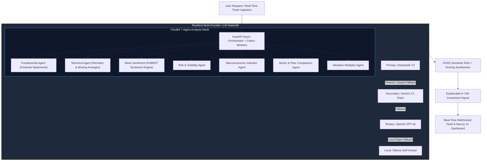
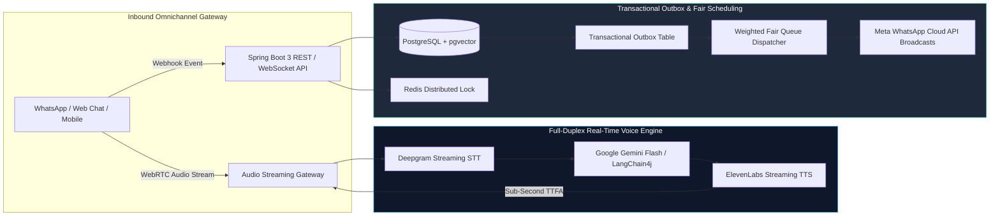

<div align="center">

# Himanshu Bharti
### **Software Development Engineer | Backend, Distributed Systems & AI**
**Junior Research Fellow (National Quantum Mission, DST at IIIT Bhagalpur) • Ex-Mobiloitte SDE**

[](https://hkbharti77.website)
&nbsp;
[](https://www.linkedin.com/in/himanshu-bharti-81a5a618a)
&nbsp;
[](mailto:hkbharti77@gmail.com)
&nbsp;
[](tel:+917050047159)
&nbsp;
[](https://github.com/hkbharti77)

<br/>

```text
┌─────────────────────────────────────────────────────────────────────────────────────────────┐
│  CORE DOMAIN : High-Performance Python & Java Microservices, GenAI Systems & Lab Computing   │
│  CURRENT     : JRF @ National Quantum Mission (DST, Govt. of India) | Dept. of ECE, IIIT-BH  │
│  INVARIANT   : Bounded State Machines > Stochastic Loops | Resilient Failover & Idempotency │
└─────────────────────────────────────────────────────────────────────────────────────────────┘
```

</div>

---

## ⚡ Verified Production Benchmarks & Impact

<div align="center">

| **-30% Query Latency** | **-45% Inference Latency** | **Sub-Second TTFA** |
| :---: | :---: | :---: |
| Hybrid RAG with Redis semantic caching | Spring AI + Gemini prompt routing & caching | Streaming STT/TTS real-time voice pipeline |
| **10,000+ Interactions** | **+35% Lead Response** | **-25% Ticket Resolution** |
| Outbound calling & campaign broadcast engines | Event-driven Slack Bot webhook router | Omnichannel live agent handoff system |

</div>

---

## 👨‍💻 Professional Summary

Software Development Engineer and **Junior Research Fellow (National Quantum Mission, DST at IIIT Bhagalpur)** with experience engineering high-performance **Python (FastAPI)** and **Java (Spring Boot)** backend microservices, GenAI systems, and scientific computing/hardware instrumentation software.

* **Specializations:** Hybrid RAG pipelines (`LangChain`, `FAISS`, `pgvector`), real-time Voice AI calling agents (`Deepgram`, `ElevenLabs`, WebSockets/WebRTC), and multi-channel bots (`WhatsApp Cloud API`, `Telegram`, `Slack`).
* **Systems & Data Layer:** Scalable database architectures (`PostgreSQL`, `MongoDB`, `MySQL`), `Redis` distributed locks & semantic caching, Docker containerization, and resilient cloud microservices.
* **Scientific Computing:** Developing automated data acquisition (DAQ) workflows, C/C++ hardware-interfacing logic, and numerical modeling for quantum technology test benches under the National Quantum Mission (DST).

---

## 🏗️ System Architecture Blueprints

### 01. AI Stock Kundli: 7-Agent Parallel Analysis & Multi-LLM Waterfall



---

### 02. GyanVaniAI Connect: Voice AI & Transactional Outbox Architecture



---

## 💼 Professional Experience

### 🔬 Indian Institute of Information Technology (IIIT) Bhagalpur
**Junior Research Fellow (JRF) – Quantum Technologies** | *Oct 2026 – Present* | *Bhagalpur, Bihar, India*
* **National Quantum Mission (NQM):** Appointed as JRF for the project *“Undergraduate Teaching Laboratories in Quantum Technologies”* sponsored by the **Department of Science and Technology (DST), Govt. of India**, in the Dept. of ECE under Dr. Dheeraj Kr. Sinha.
* **Control & Acquisition:** Designing and developing software control modules, automated data acquisition (DAQ) workflows, and simulation tools in **Python** and **C/C++** for experimental quantum test benches.
* **Hardware Interfacing:** Implementing low-level interfacing logic and backend computational routines to communicate with laboratory instrumentation, stream experimental measurements, and automate testing protocols.
* **Modeling & Simulation:** Performing numerical modeling, algorithmic verification, and data analysis for quantum physical systems and educational lab modules.

---

### 💻 Mobiloitte Technologies
**Software Development Engineer (Full Stack & AI)** | *May 2025 – Oct 2026* | *New Delhi, India*
* **Cross-Platform Conversational AI:** Built and deployed AI bots across 5 channels (WhatsApp, Telegram, Instagram, Slack, Web Chat) using **FastAPI** and **Hybrid RAG** (dense vector + BM25), improving context relevance and cutting query latency by **30% via Redis semantic caching**.
* **Omnichannel Live Agent Handoff:** Engineered an enterprise agent handoff system across 4 messaging platforms supporting text, rich media (audio, images, PDFs, video), cutting customer ticket resolution time by **25%**.
* **Slack Lead & Ticketing Engine:** Integrated an event-driven Slack Bot parsing incoming leads and dispatching real-time ticket routing via asynchronous webhooks, boosting lead response rate by **35%**.
* **Real-Time Voice AI & IVR:** Architected conversational Voice AI Agents using **Deepgram Streaming STT**, **ElevenLabs TTS**, and bidirectional WebSockets, optimizing for **sub-second Time-to-First-Audio (TTFA)**.
* **Outbound Broadcast Engines:** Scaled outbound calling and messaging engines handling **10,000+ interactions** with asynchronous job scheduling, intent classification, and conversational branching.
* **Meta WhatsApp Cloud API:** Implemented WhatsApp Embedded Signup and Cloud API workflows, automating onboarding for 10+ enterprise WABA client accounts with **idempotent webhook processing and delivery retries**.
* **Tenant-Isolated Data Architecture:** Designed multi-tenant data storage across **PostgreSQL**, **MongoDB**, and **Redis**, containerizing services with **Docker** for high availability.

---

### 🛠️ QSpiders
**Full Stack Developer Intern** | *Aug 2024 – Apr 2025* | *Noida, India*
* **Java & Spring Boot Microservices:** Developed backend RESTful APIs using Java and Spring Boot, implementing layered MVC architecture, Bean Validation (JSR-380), and centralized exception handling, reducing API response times by **20%**.
* **Database Query Optimization:** Designed normalized relational schemas in **MySQL**, accelerating complex join queries by **25%** via composite B-tree indexing and `EXPLAIN` query execution plan profiling.
* **Client Dashboards:** Built modular UI components and responsive dashboards using **React** and **Vite**, integrating asynchronous REST endpoints.
* **Testing & Quality Assurance:** Authored unit and integration test suites using **JUnit** and **Mockito** with Postman automated collections, maintaining **80%+ test coverage**.

---

## 🚀 Featured Engineering Projects

### 📈 01. AI Stock Kundli – Enterprise Investment Intelligence Platform
* **Architecture:** Full-stack, multi-tenant SaaS platform analyzing NSE/BSE equities via a parallel **7-agent AI architecture** (Fundamental, Technical, News, Risk, Macro, Sector, Valuation) generating explainable 0–100 scoring signals.
* **Resilient LLM Waterfall:** Built automatic failover pipeline (`DeepSeek V3` → `Gemini 2.5 Flash` → `GPT-4o` → `Ollama local`), integrated **FinBERT** sentiment scoring, and implemented a **FAISS** vector RAG pipeline for equities research.
* **Backend & Real-Time Stream:** Asynchronous **FastAPI** backend with **SQLAlchemy 2.0**, Redis quotas/caching, Celery task workers, and real-time WebSocket market feeds.
* **Client:** Interactive **Next.js 14 / TypeScript** dashboard with Recharts financial charts, bilingual support (English/Hindi), and secure **Razorpay** billing with HMAC signature verification.
* **Tech Stack:** `Python`, `FastAPI`, `Next.js 14`, `TypeScript`, `PostgreSQL`, `Redis`, `FAISS`, `FinBERT`, `Docker`, `WebSockets`.

---

### 🏢 02. GyanVaniAI Connect – Enterprise Multi-Tenant AI CRM & Marketing Suite
* **Architecture:** Enterprise SaaS with strict tenant isolation, dynamic Role-Based Access Control (RBAC), and automated lead ingestion from Web and WhatsApp bots.
* **Voice AI Calling Agent:** Real-time WhatsApp Voice Calling Agent supporting **WebRTC** and SIP/TLS signaling, full-duplex speech streaming via **Deepgram STT**, **Gemini Flash**, and **ElevenLabs TTS**, with Redis ephemeral session & SDP management.
* **RAG & Lead Triage:** **LangChain4j** + **pgvector** knowledge retrieval, real-time sentiment scoring, and automated 0–100 lead qualification with seamless bot-to-human escalation.
* **High-Throughput Campaign Dispatcher:** Broadcast engine for bulk WhatsApp notifications and automated email campaigns via a **Weighted Fair Queue (WFQ)** with starvation-free scheduling.
* **Reliability:** Atomic chat distribution using PostgreSQL pessimistic row locking, Redis distributed locks, and the **Transactional Outbox Pattern** for guaranteed message delivery.
* **Tech Stack:** `Java 17`, `Spring Boot 3`, `React`, `TypeScript`, `PostgreSQL`, `pgvector`, `Redis`, `WebRTC`, `LangChain4j`, `Gemini API`.

---

### 📱 03. Enterprise AI Social Media Automation & Marketing SaaS Platform
* **AI Content Orchestration:** Enterprise platform automating AI content generation, multi-platform publishing (Meta Graph API, LinkedIn, X/Twitter), and engagement telemetry.
* **Prompt Optimization:** Integrated **Spring AI** with **Google Gemini GenAI**, semantic prompt routing, and Redis response caching, cutting average response latency by **45%** and reducing token expenditure.
* **Background Publishing:** Scheduled publishing workers using **Redis Distributed Locks** and cron jobs to prevent race conditions or duplicate posts under concurrent loads.
* **Fault Tolerance:** Built with **Bucket4j** token-bucket rate limiting, **Resilience4j** Circuit Breakers, AWS S3 multipart media uploads, and tiered Razorpay billing.
* **Tech Stack:** `Java 21`, `Spring Boot 3.3`, `Spring AI`, `React 19`, `TypeScript`, `PostgreSQL`, `Redis`, `AWS S3`, `Resilience4j`, `Docker`.

---

## 🛠️ Technical Competencies

| Domain | Technologies & Frameworks |
| :--- | :--- |
| **Languages & Backend** | `Python`, `Java (17/21)`, `C/C++`, `SQL`, `JavaScript`, `TypeScript`, `FastAPI`, `Spring Boot 3`, `RESTful APIs`, `WebSockets`, `Microservices` |
| **AI, RAG & LLM Systems** | `RAG Pipelines`, `LangChain`, `LangGraph`, `LangChain4j`, `LlamaIndex`, `FAISS`, `pgvector`, `Pinecone`, `Qdrant`, `FinBERT`, `Prompt Engineering` |
| **Databases & Caching** | `PostgreSQL`, `MongoDB`, `MySQL`, `Redis (Distributed Locking & Semantic Caching)`, `SQLAlchemy`, `Hibernate` |
| **Real-Time Voice & Streaming** | `WebRTC`, `Deepgram Streaming STT`, `ElevenLabs TTS`, `VAD (Voice Activity Detection)`, `Full-Duplex Audio Buffering` |
| **Cloud, DevOps & Tools** | `Docker`, `AWS (EC2, S3)`, `Git`, `GitHub Actions`, `Nginx`, `Linux`, `MATLAB`, `Postman` |
| **Integrations & Frontend** | `Meta WhatsApp Cloud API`, `Slack API`, `React`, `Next.js 14`, `Vite`, `Tailwind CSS`, `Razorpay API` |

---

## 📜 Certifications & Education

### Certifications
* **Salesforce Trailhead Superbadges:** Apex Specialist & Process Automation Specialist (2024)
* **Cisco CyberOps Associate:** Cisco Networking Academy (2024)
* **Cisco CCNA:** Introduction to Networks (CCNAv7) – Cisco Networking Academy (2023)

### Education
* **Bachelor of Technology (B.Tech) – Electronics & Communication Engineering**
  * *Bihar Engineering University* | **CGPA: 7.8 / 10** | *2020 – 2024*
* **Class XII (Senior Secondary) – Science (PCM)**
  * *R.M. College (BSEB), Saharsa, Bihar* | **68%** | *2018 – 2020*
* **Class X (Secondary School Certificate)**
  * *St. Xavier’s School, Saharsa, Bihar* | **CGPA: 9.4 / 10**

---

## 💡 Engineering Invariants & Principles

```text
1. BOUNDED STATE MACHINES OVER UNCHECKED LOOPS
   Deterministic state graphs (LangGraph / LangChain4j) with strict Pydantic/Java schema bounds 
   prevent infinite conversational loops, isolate failure states, and guarantee predictable token costs.

2. MULTI-PROVIDER WATERFALL FOR MISSION-CRITICAL AI
   Single-provider LLM dependencies introduce severe operational risk. Implementing tiered 
   waterfall failovers (DeepSeek -> Gemini -> GPT-4o -> Local Ollama) ensures 99.9% availability.

3. IDEMPOTENT BY DEFAULT & THE TRANSACTIONAL OUTBOX
   In multi-channel webhook architectures (WhatsApp, Slack, Stripe/Razorpay), network retries are 
   inevitable. Redis distributed locks and the Transactional Outbox Pattern ensure exactly-once processing.

4. REAL-TIME LATENCY DECOMPOSITION
   Sub-second Voice AI turnaround requires optimizing every micro-hop: streaming 20-30ms audio 
   frames over WebSockets/WebRTC, streaming interim tokens, and pipelining early sentences into TTS synthesis.
```

---

## 📬 Contact & Connect

<div align="center">

[](https://hkbharti77.website)
&nbsp;
[](https://www.linkedin.com/in/himanshu-bharti-81a5a618a)
&nbsp;
[](mailto:hkbharti77@gmail.com)
&nbsp;
[](https://wa.me/917050047159)

<br/>

<sub>© Himanshu Bharti • SDE & Junior Research Fellow (National Quantum Mission) • Built for technical rigor & clarity.</sub>

</div>
