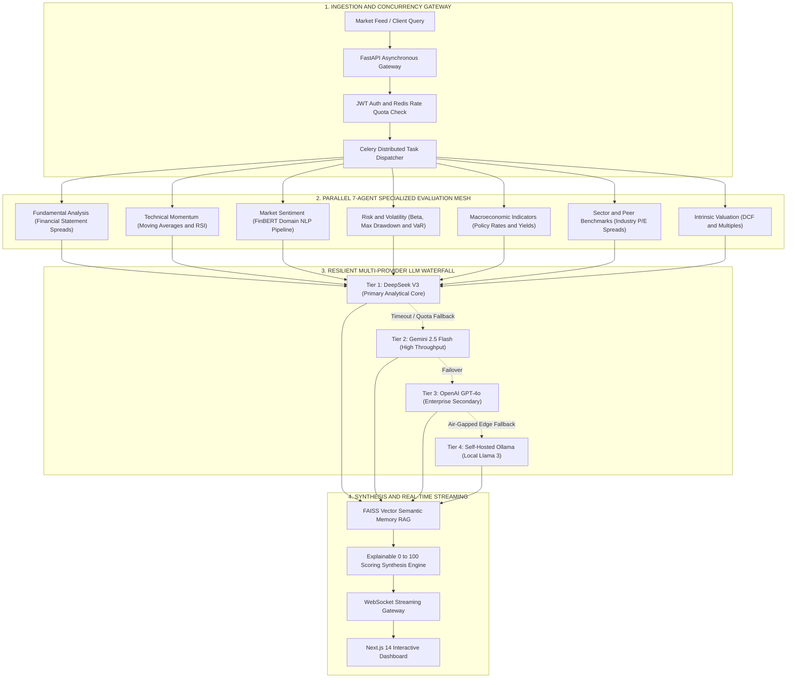
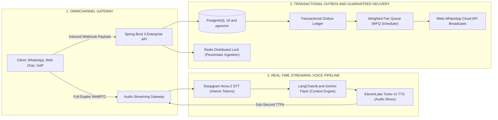

<div align="center">

<!-- Enterprise Header & Status Telemetry -->
<table width="100%" border="0" cellspacing="0" cellpadding="0">
  <tr>
    <td align="center" bgcolor="#0B0F19" style="padding: 28px 20px; border-radius: 10px; border: 1px solid #1E293B;">
      <p align="center" style="margin: 0; font-size: 11px; font-weight: bold; color: #38BDF8; letter-spacing: 2px;">ENTERPRISE SYSTEMS & AI ENGINEERING DOSSIER</p>
      <h1 align="center" style="margin: 10px 0 6px 0; font-size: 32px; font-weight: 800; color: #F8FAFC;">HIMANSHU BHARTI</h1>
      <p align="center" style="margin: 0 0 14px 0; font-size: 14px; color: #94A3B8;">
        <b>Software Development Engineer</b> | Distributed Backend Systems | Conversational AI | Hybrid RAG
      </p>
      <p align="center" style="margin: 0 0 16px 0;">
        
        &nbsp;
        
        &nbsp;
        
      </p>
      <p align="center" style="margin: 0;">
        <a href="https://hkbharti77.website"></a>
        &nbsp;
        <a href="https://www.linkedin.com/in/himanshu-bharti-81a5a618a"></a>
        &nbsp;
        <a href="mailto:hkbharti77@gmail.com"></a>
        &nbsp;
        <a href="https://wa.me/917050047159"></a>
        &nbsp;
        <a href="https://github.com/hkbharti77"></a>
      </p>
    </td>
  </tr>
</table>

</div>

<br/>

---

## ⚡ Executive Telemetry & Verified Performance Metrics

<table width="100%" border="0" cellspacing="8" cellpadding="12">
  <tr>
    <td width="33%" bgcolor="#0F172A" style="border: 1px solid #1E293B; border-radius: 8px;">
      <p style="margin: 0; font-size: 11px; font-family: monospace; color: #38BDF8; font-weight: bold;">LATENCY PROFILE // RAG</p>
      <h2 style="margin: 4px 0; color: #38BDF8; font-size: 24px; font-weight: 800;">-30% P95</h2>
      <p style="margin: 0; font-size: 12px; color: #94A3B8; line-height: 1.4;">
        <b>Query Latency Reduction:</b> Hybrid dense (pgvector) + lexical (BM25) search with Redis semantic response caching.
      </p>
    </td>
    <td width="33%" bgcolor="#0F172A" style="border: 1px solid #1E293B; border-radius: 8px;">
      <p style="margin: 0; font-size: 11px; font-family: monospace; color: #38BDF8; font-weight: bold;">INFERENCE EFFICIENCY // GENAI</p>
      <h2 style="margin: 4px 0; color: #38BDF8; font-size: 24px; font-weight: 800;">-45% Overhead</h2>
      <p style="margin: 0; font-size: 12px; color: #94A3B8; line-height: 1.4;">
        <b>LLM Compute & Latency Cut:</b> Spring AI + Gemini semantic prompt routing with Redis in-memory cache deduplication.
      </p>
    </td>
    <td width="33%" bgcolor="#0F172A" style="border: 1px solid #1E293B; border-radius: 8px;">
      <p style="margin: 0; font-size: 11px; font-family: monospace; color: #38BDF8; font-weight: bold;">VOICE SLA // STREAMING</p>
      <h2 style="margin: 4px 0; color: #38BDF8; font-size: 24px; font-weight: 800;">&lt; 1,000ms</h2>
      <p style="margin: 0; font-size: 12px; color: #94A3B8; line-height: 1.4;">
        <b>Time-to-First-Audio (TTFA):</b> Deepgram Nova-2 streaming STT &rarr; LLM SSE tokens &rarr; ElevenLabs Turbo WebRTC audio.
      </p>
    </td>
  </tr>
  <tr>
    <td width="33%" bgcolor="#0F172A" style="border: 1px solid #1E293B; border-radius: 8px;">
      <p style="margin: 0; font-size: 11px; font-family: monospace; color: #10B981; font-weight: bold;">INGESTION CAPACITY // SCALE</p>
      <h2 style="margin: 4px 0; color: #10B981; font-size: 24px; font-weight: 800;">10,000+ Events</h2>
      <p style="margin: 0; font-size: 12px; color: #94A3B8; line-height: 1.4;">
        <b>Outbound Campaign Engine:</b> Automated calling & WhatsApp broadcast engines with asynchronous job scheduling.
      </p>
    </td>
    <td width="33%" bgcolor="#0F172A" style="border: 1px solid #1E293B; border-radius: 8px;">
      <p style="margin: 0; font-size: 11px; font-family: monospace; color: #10B981; font-weight: bold;">INCIDENT TRIAGE // WEBHOOKS</p>
      <h2 style="margin: 4px 0; color: #10B981; font-size: 24px; font-weight: 800;">+35% Velocity</h2>
      <p style="margin: 0; font-size: 12px; color: #94A3B8; line-height: 1.4;">
        <b>Lead & Alert Routing:</b> Event-driven Slack Bot engine with cryptographic HMAC verification and asynchronous webhooks.
      </p>
    </td>
    <td width="33%" bgcolor="#0F172A" style="border: 1px solid #1E293B; border-radius: 8px;">
      <p style="margin: 0; font-size: 11px; font-family: monospace; color: #10B981; font-weight: bold;">OPERATIONAL EFFICIENCY // LIVE HANDOFF</p>
      <h2 style="margin: 4px 0; color: #10B981; font-size: 24px; font-weight: 800;">-25% Ticket Duration</h2>
      <p style="margin: 0; font-size: 12px; color: #94A3B8; line-height: 1.4;">
        <b>Omnichannel Agent Handoff:</b> 4-channel real-time agent handoff with full rich-media support (audio, video, documents).
      </p>
    </td>
  </tr>
</table>

---

## 🏛️ Enterprise Systems Engineering Matrix

| Architectural Domain | Production Specifications & Implementation Patterns |
| :--- | :--- |
| **Microservices & Protocols** | `Python (FastAPI, AsyncIO)`, `Java (Spring Boot 3)`, `C/C++`, `RESTful APIs`, `WebSockets`, `WebRTC DataChannels`, `SIP/TLS Signaling`, `JSR-380 Bean Validation`. |
| **GenAI & Agentic Orchestration** | `LangChain4j`, `LangGraph`, `Spring AI`, `LlamaIndex`, `Multi-Agent Parallel Mesh`, `Structured Output Schema Enforcement (Pydantic / Zod)`, `Prompt Caching`. |
| **Retrieval & Semantic Indexing** | `PostgreSQL (pgvector HNSW)`, `FAISS`, `Pinecone`, `Qdrant`, `Lexical BM25`, `Reciprocal Rank Fusion (RRF)`, `FinBERT Domain Sentiment NLP`. |
| **High-Availability Storage** | `PostgreSQL (Row-Level Security Multi-Tenancy)`, `MongoDB`, `MySQL (B-Tree Indexing)`, `Redis (Distributed Locks, Semantic Cache, Ephemeral Session State)`. |
| **Resilient Event Pipelines** | `Transactional Outbox Pattern`, `Weighted Fair Queue (WFQ) Scheduling`, `Resilience4j Circuit Breakers`, `Bucket4j Token-Bucket Rate Limiting`. |
| **Quantum Computing & DAQ** | `Python / C++ Hardware Interfacing Logic`, `Automated DAQ Pipelines`, `Numerical Modeling for Quantum Physics Test Benches (DST NQM)`. |

---

## 📐 Enterprise Architecture Case Studies

### 01. AI Stock Kundli: 7-Agent Parallel Analysis & Multi-Provider LLM Waterfall

> **Classification:** High-Throughput Financial Intelligence & Equities Evaluation Platform  
> **Production Stack:** `Python` • `FastAPI` • `Next.js 14` • `TypeScript` • `FAISS` • `FinBERT` • `Redis` • `PostgreSQL` • `Docker`



<details open>
<summary><b>Enterprise Systems Specification & Architecture Details</b></summary>
<br/>

* **Concurrency Architecture:** Built on FastAPI async event loops backed by SQLAlchemy 2.0 and Celery workers to evaluate all 7 analytical agents in parallel without blocking client socket connections.
* **Cascading Failover Waterfall:** Solves single-provider LLM fragility by cascading through tiered providers. If primary provider quotas or latencies exceed configured SLAs (2,500ms), requests seamlessly route to secondary and edge models without client disruption.
* **Financial NLP & Domain Grounding:** Couples FinBERT transfer learning for market news sentiment with FAISS vector similarity search across quarterly filings and financial disclosures.
* **Production Integrity:** Implements end-to-end Razorpay subscription checkout with cryptographic HMAC-SHA256 webhook validation and Redis subscription quota counters.

</details>

---

### 02. GyanVaniAI Connect: Low-Latency Voice AI & Transactional Outbox CRM

> **Classification:** Enterprise Multi-Tenant AI CRM, Conversational IVR & Campaign Engine  
> **Production Stack:** `Java 17` • `Spring Boot 3` • `PostgreSQL` • `pgvector` • `Redis` • `WebRTC` • `LangChain4j` • `Gemini API` • `ElevenLabs`



<details open>
<summary><b>Enterprise Systems Specification & Architecture Details</b></summary>
<br/>

* **Full-Duplex Voice Latency Profile:** WebRTC UDP media transport combined with Deepgram interim token streaming allows sentence boundary forwarding directly into ElevenLabs Turbo, achieving sub-second Time-to-First-Audio.
* **Transactional Outbox Guarantee:** Inbound webhooks write state changes to PostgreSQL and the outbox ledger within a single ACID transaction. Asynchronous dispatchers poll the ledger to guarantee at-least-once broadcast delivery without distributed two-phase commit overhead.
* **Starvation-Free Fair Scheduling:** Weighted Fair Queueing (WFQ) prioritizes high-priority incoming customer interactions over bulk background broadcast queues.
* **Concurrency & Race Elimination:** PostgreSQL pessimistic locking (`FOR UPDATE`) alongside Redis distributed locks prevents double-allocation of incoming leads during high-concurrency campaigns.

</details>

---

## 💼 Professional Experience & Research Fellowship

### 🔬 Indian Institute of Information Technology (IIIT) Bhagalpur
**Junior Research Fellow (JRF) – Quantum Technologies** | *Oct 2026 – Present* | *Bhagalpur, Bihar, India*
* **National Quantum Mission (NQM):** Appointed as JRF under the project *“Undergraduate Teaching Laboratories in Quantum Technologies”* sponsored by the **Department of Science and Technology (DST), Govt. of India**, in the Dept. of ECE under Dr. Dheeraj Kr. Sinha.
* **Automated DAQ Systems:** Architecting low-level control modules and automated data acquisition (DAQ) workflows in **Python** and **C/C++** for experimental quantum test benches.
* **Hardware Interfacing & Telemetry:** Engineering computational backend routines interfacing laboratory instrumentation to stream experimental measurements with precision timing.
* **Physical System Modeling:** Performing numerical simulations, algorithm verification, and quantitative modeling of quantum physical systems.

---

### 💻 Mobiloitte Technologies
**Software Development Engineer (Full Stack & AI)** | *May 2025 – Oct 2026* | *New Delhi, India*
* **Multi-Channel Conversational AI:** Engineered bots across 5 channels (WhatsApp, Telegram, Instagram, Slack, Web Chat) via FastAPI & Hybrid RAG (dense + BM25), reducing query latency by **30% via Redis semantic caching**.
* **Live Agent Handoff Product:** Built an enterprise multi-channel live agent handoff system with rich media support, reducing ticket resolution time by **25%**.
* **Event-Driven Triage:** Integrated an asynchronous Slack Bot ticketing engine parsing leads and dispatching webhooks, lifting lead response rates by **35%**.
* **Voice AI Calling Agents:** Architected real-time IVR pipelines using Deepgram STT, ElevenLabs TTS, and bidirectional WebSockets for **sub-second Time-to-First-Audio (TTFA)**.
* **Campaign Broadcast Engine:** Scaled outbound campaign architectures handling **10,000+ interactions** with asynchronous job scheduling and intent branching.
* **Enterprise WABA Provisioning:** Implemented Meta WhatsApp Cloud API and Embedded Signup workflows, onboarding 10+ enterprise WABA client accounts with idempotent webhook processing.

---

### 🛠️ QSpiders
**Full Stack Developer Intern** | *Aug 2024 – Apr 2025* | *Noida, India*
* **Spring Boot Microservices:** Developed backend RESTful APIs with Spring Boot, implementing layered MVC, Bean Validation (JSR-380), and centralized exception handling, cutting API response times by **20%**.
* **Relational Query Optimization:** Optimized MySQL relational schemas, accelerating complex join queries by **25%** through composite B-tree indexing and `EXPLAIN` execution plan tuning.
* **Testing & Reliability:** Authored unit and integration test suites using JUnit and Mockito, sustaining **80%+ test coverage** across core service layers.

---

## 🏛️ Systems Principles & Operational Invariants

```text
[PRINCIPLE 01] BOUNDED STATE CHARTS OVER UNCHECKED LOOPS
In mission-critical agentic architectures, unbounded autonomous loops create runaway latency,
state drift, and catastrophic token consumption. Deterministic state machines with strict
schema enforcement (Pydantic / Zod / Java Records) isolate failure domains and guarantee bounded cost.

[PRINCIPLE 02] MULTI-PROVIDER WATERFALL FOR MISSION-CRITICAL UPTIME
Single-model dependencies introduce single-point-of-failure vulnerabilities. Cascading
fallbacks (DeepSeek -> Gemini -> GPT-4o -> Local Edge Ollama) maintain 99.9% service availability
under API rate limits, provider outages, or network partitions.

[PRINCIPLE 03] TRANSACTIONAL OUTBOX & DISTRIBUTED IDEMPOTENCY
In multi-channel webhook architectures (WhatsApp, Slack, Payment Gateways), duplicate events
and out-of-order retries are guaranteed occurrences. Enforce Redis distributed locks and the
Transactional Outbox Pattern to guarantee exactly-once execution side-effects.

[PRINCIPLE 04] FULL-DUPLEX LATENCY DECOMPOSITION
Sub-second real-time Voice AI turnaround cannot be achieved through transport protocols alone.
It demands holistic systems engineering: 20–30ms PCM audio chunking, streaming interim STT tokens,
early sentence boundary synthesis handoffs, and instant barge-in buffer cancellation.
```

---

## 📜 Academic Credentials & Enterprise Certifications

<table width="100%" border="0" cellspacing="8" cellpadding="12">
  <tr>
    <td width="50%" bgcolor="#0F172A" style="border: 1px solid #1E293B; border-radius: 8px;" valign="top">
      <p style="margin: 0 0 8px 0; color: #38BDF8; font-size: 13px; font-weight: bold;">ENTERPRISE CERTIFICATIONS</p>
      <p style="margin: 0 0 4px 0; font-size: 13px; color: #F8FAFC;">
        <b>Salesforce Trailhead Superbadges</b>
      </p>
      <p style="margin: 0 0 10px 0; font-size: 12px; color: #94A3B8;">
        Apex Specialist • Process Automation Specialist (2024)
      </p>
      <p style="margin: 0 0 4px 0; font-size: 13px; color: #F8FAFC;">
        <b>Cisco CyberOps Associate</b>
      </p>
      <p style="margin: 0 0 10px 0; font-size: 12px; color: #94A3B8;">
        Cisco Networking Academy (2024)
      </p>
      <p style="margin: 0 0 4px 0; font-size: 13px; color: #F8FAFC;">
        <b>Cisco CCNA: Introduction to Networks (CCNAv7)</b>
      </p>
      <p style="margin: 0; font-size: 12px; color: #94A3B8;">
        Cisco Networking Academy (2023)
      </p>
    </td>
    <td width="50%" bgcolor="#0F172A" style="border: 1px solid #1E293B; border-radius: 8px;" valign="top">
      <p style="margin: 0 0 8px 0; color: #10B981; font-size: 13px; font-weight: bold;">ACADEMIC BACKGROUND</p>
      <p style="margin: 0 0 2px 0; font-size: 13px; color: #F8FAFC;">
        <b>Bachelor of Technology (B.Tech)</b>
      </p>
      <p style="margin: 0 0 2px 0; font-size: 12px; color: #38BDF8;">
        Electronics & Communication Engineering • <b>CGPA: 7.8 / 10</b>
      </p>
      <p style="margin: 0 0 10px 0; font-size: 11px; color: #94A3B8;">
        Bihar Engineering University • <i>2020 – 2024</i>
      </p>
      <p style="margin: 0 0 2px 0; font-size: 13px; color: #F8FAFC;">
        <b>Class XII (Senior Secondary) – Science (PCM)</b>
      </p>
      <p style="margin: 0 0 10px 0; font-size: 11px; color: #94A3B8;">
        R.M. College (BSEB), Saharsa • <b>68%</b> • <i>2018 – 2020</i>
      </p>
      <p style="margin: 0 0 2px 0; font-size: 13px; color: #F8FAFC;">
        <b>Class X (Secondary School Certificate)</b>
      </p>
      <p style="margin: 0; font-size: 11px; color: #94A3B8;">
        St. Xavier’s School, Saharsa • <b>CGPA: 9.4 / 10</b>
      </p>
    </td>
  </tr>
</table>

---

## 📬 Enterprise Communication & Direct Dispatch

<div align="center">

<p align="center">
  <a href="https://hkbharti77.website"></a>
  &nbsp;
  <a href="https://www.linkedin.com/in/himanshu-bharti-81a5a618a"></a>
  &nbsp;
  <a href="mailto:hkbharti77@gmail.com"></a>
  &nbsp;
  <a href="https://wa.me/917050047159"></a>
</p>

<sub><b>&copy; 2026 HIMANSHU BHARTI</b> • Software Development Engineer & Junior Research Fellow (National Quantum Mission, DST) • Engineered for enterprise precision.</sub>

</div>
