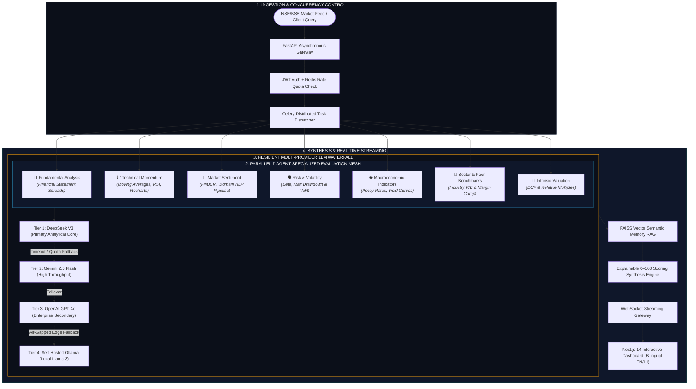
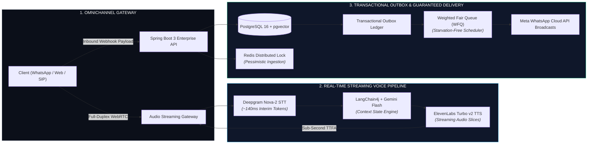

<div align="center">

<!-- Enterprise Header & Status Telemetry -->
<table width="100%" border="0" cellspacing="0" cellpadding="0">
  <tr>
    <td align="center" bgcolor="#0B0F19" style="padding: 32px 24px; border-radius: 12px; border: 1px solid #1E293B;">
      <span style="letter-spacing: 3px; font-size: 11px; font-weight: 700; color: #38BDF8; text-transform: uppercase;">● ENTERPRISE SYSTEMS & AI ENGINEERING DOSSIER</span>
      <h1 style="margin: 12px 0 6px 0; font-size: 34px; font-weight: 800; color: #F8FAFC; letter-spacing: -0.5px;">HIMANSHU BHARTI</h1>
      <p style="margin: 0 0 16px 0; font-size: 15px; color: #94A3B8; font-weight: 500;">
        <b>Software Development Engineer</b> &bull; Distributed Backend Systems &bull; Conversational AI &bull; Hybrid RAG
      </p>
      <div style="display: inline-block; padding: 6px 14px; background: rgba(16, 185, 129, 0.1); border: 1px solid rgba(16, 185, 129, 0.3); border-radius: 9999px; margin-bottom: 20px;">
        <span style="color: #10B981; font-size: 12px; font-weight: 600;">🟢 ACTIVE: Junior Research Fellow @ National Quantum Mission (DST, Govt. of India) &bull; Dept. of ECE, IIIT Bhagalpur</span>
      </div>
      <br/>
      <a href="https://hkbharti77.website"></a>
      &nbsp;
      <a href="https://www.linkedin.com/in/himanshu-bharti-81a5a618a"></a>
      &nbsp;
      <a href="mailto:hkbharti77@gmail.com"></a>
      &nbsp;
      <a href="https://wa.me/917050047159"></a>
      &nbsp;
      <a href="https://github.com/hkbharti77"></a>
    </td>
  </tr>
</table>

</div>

<br/>

---

## ⚡ Executive Telemetry & Verified Performance Metrics

<table width="100%" border="0" cellspacing="8" cellpadding="14">
  <tr>
    <td width="33%" bgcolor="#0F172A" style="border: 1px solid #1E293B; border-radius: 8px;">
      <span style="font-size: 10px; font-family: monospace; color: #38BDF8; font-weight: bold; text-transform: uppercase;">LATENCY PROFILE // RAG</span>
      <h2 style="margin: 6px 0; color: #38BDF8; font-size: 26px; font-weight: 800;">-30% P95</h2>
      <p style="margin: 0; font-size: 12px; color: #94A3B8; line-height: 1.4;">
        <b>Query Latency Reduction:</b> Hybrid dense (pgvector) + lexical (BM25) search with Redis semantic response caching.
      </p>
    </td>
    <td width="33%" bgcolor="#0F172A" style="border: 1px solid #1E293B; border-radius: 8px;">
      <span style="font-size: 10px; font-family: monospace; color: #38BDF8; font-weight: bold; text-transform: uppercase;">INFERENCE EFFICIENCY // GENAI</span>
      <h2 style="margin: 6px 0; color: #38BDF8; font-size: 26px; font-weight: 800;">-45% Overhead</h2>
      <p style="margin: 0; font-size: 12px; color: #94A3B8; line-height: 1.4;">
        <b>LLM Compute & Latency Cut:</b> Spring AI + Gemini semantic prompt routing with Redis in-memory cache deduplication.
      </p>
    </td>
    <td width="33%" bgcolor="#0F172A" style="border: 1px solid #1E293B; border-radius: 8px;">
      <span style="font-size: 10px; font-family: monospace; color: #38BDF8; font-weight: bold; text-transform: uppercase;">VOICE SLA // STREAMING</span>
      <h2 style="margin: 6px 0; color: #38BDF8; font-size: 26px; font-weight: 800;">&lt; 1,000ms</h2>
      <p style="margin: 0; font-size: 12px; color: #94A3B8; line-height: 1.4;">
        <b>Time-to-First-Audio (TTFA):</b> Deepgram Nova-2 streaming STT &rarr; LLM SSE tokens &rarr; ElevenLabs Turbo WebRTC audio.
      </p>
    </td>
  </tr>
  <tr>
    <td width="33%" bgcolor="#0F172A" style="border: 1px solid #1E293B; border-radius: 8px;">
      <span style="font-size: 10px; font-family: monospace; color: #10B981; font-weight: bold; text-transform: uppercase;">INGESTION CAPACITY // SCALE</span>
      <h2 style="margin: 6px 0; color: #10B981; font-size: 26px; font-weight: 800;">10,000+ Events</h2>
      <p style="margin: 0; font-size: 12px; color: #94A3B8; line-height: 1.4;">
        <b>Outbound Campaign Engine:</b> Automated calling & WhatsApp broadcast engines with asynchronous job scheduling.
      </p>
    </td>
    <td width="33%" bgcolor="#0F172A" style="border: 1px solid #1E293B; border-radius: 8px;">
      <span style="font-size: 10px; font-family: monospace; color: #10B981; font-weight: bold; text-transform: uppercase;">INCIDENT TRIAGE // WEBHOOKS</span>
      <h2 style="margin: 6px 0; color: #10B981; font-size: 26px; font-weight: 800;">+35% Velocity</h2>
      <p style="margin: 0; font-size: 12px; color: #94A3B8; line-height: 1.4;">
        <b>Lead & Alert Routing:</b> Event-driven Slack Bot engine with cryptographic HMAC verification and asynchronous webhooks.
      </p>
    </td>
    <td width="33%" bgcolor="#0F172A" style="border: 1px solid #1E293B; border-radius: 8px;">
      <span style="font-size: 10px; font-family: monospace; color: #10B981; font-weight: bold; text-transform: uppercase;">OPERATIONAL EFFICIENCY // LIVE HANDOFF</span>
      <h2 style="margin: 6px 0; color: #10B981; font-size: 26px; font-weight: 800;">-25% Ticket Duration</h2>
      <p style="margin: 0; font-size: 12px; color: #94A3B8; line-height: 1.4;">
        <b>Omnichannel Agent Handoff:</b> 4-channel real-time agent handoff with full rich-media support (audio, video, documents).
      </p>
    </td>
  </tr>
</table>

---

## 🏛️ Enterprise Systems Engineering Matrix

```text
┌───────────────────────────────┬────────────────────────────────────────────────────────────────────────┐
│ ARCHITECTURAL DOMAIN          │ PRODUCTION SPECIFICATIONS & IMPLEMENTATION PATTERNS                   │
├───────────────────────────────┼────────────────────────────────────────────────────────────────────────┤
│ Microservices & Protocols     │ Python (FastAPI, AsyncIO), Java (Spring Boot 3), C/C++, RESTful,      │
│                               │ WebSockets, WebRTC DataChannels, SIP/TLS Signaling, Bean Validation.   │
├───────────────────────────────┼────────────────────────────────────────────────────────────────────────┤
│ GenAI & Agentic Orchestration │ LangChain4j, LangGraph, Spring AI, LlamaIndex, Multi-Agent Mesh,       │
│                               │ Structured Output Schema Enforcement (Pydantic / Zod), Prompt Caching. │
├───────────────────────────────┼────────────────────────────────────────────────────────────────────────┤
│ Retrieval & Semantic Indexing │ PostgreSQL (pgvector HNSW), FAISS, Pinecone, Qdrant, Lexical BM25,     │
│                               │ Reciprocal Rank Fusion (RRF), FinBERT Domain Sentiment Analysis.       │
├───────────────────────────────┼────────────────────────────────────────────────────────────────────────┤
│ High-Availability Storage     │ PostgreSQL (Row-Level Security Multi-Tenancy), MongoDB, MySQL (B-Tree),│
│                               │ Redis (Distributed Locks, Semantic Cache, Ephemeral Session State).    │
├───────────────────────────────┼────────────────────────────────────────────────────────────────────────┤
│ Resilient Event Pipelines     │ Transactional Outbox Pattern, Weighted Fair Queue (WFQ) Scheduling,   │
│                               │ Resilience4j Circuit Breakers, Bucket4j Token-Bucket Rate Limiting.   │
├───────────────────────────────┼────────────────────────────────────────────────────────────────────────┤
│ Quantum Computing & DAQ       │ Python / C++ Hardware Interfacing Logic, Automated DAQ Pipelines,      │
│                               │ Numerical Modeling for Quantum Physics Test Benches (DST NQM).         │
└───────────────────────────────┴────────────────────────────────────────────────────────────────────────┘
```

---

## 📐 Enterprise Architecture Case Studies

### 01. AI Stock Kundli: 7-Agent Parallel Analysis & Multi-Provider LLM Waterfall

> **Classification:** High-Throughput Financial Intelligence & Equities Evaluation Platform  
> **Production Stack:** `Python` &bull; `FastAPI` &bull; `Next.js 14` &bull; `TypeScript` &bull; `FAISS` &bull; `FinBERT` &bull; `Redis` &bull; `PostgreSQL` &bull; `Docker`



<details open>
<summary><b>Enterprise Systems Specification & Architecture Details</b></summary>
<br/>

* **Concurrency Architecture:** Built on FastAPI async event loops backed by SQLAlchemy 2.0 and Celery workers to evaluate all 7 analytical agents in parallel without blocking client socket connections.
* **Cascading Failover Waterfall:** Solves single-provider LLM fragility by cascading through tiered providers. If primary provider quotas or latencies exceed configured SLAs (2,500ms), requests seamlessly route to secondary and edge models without client disruption.
* **Financial NLP & Domain Grounding:** Couples FinBERT transfer learning for market news sentiment with FAISS vector similarity search across quarterly filings and financial disclosures.
* **Production Integrity:** Implements end-to-end Razorpay subscription checkout with cryptographic HMAC-SHA256 webhook validation and Redis subscription quota counters.

</details>

---

### 02. GyanVaniAI Connect: Low-Latency Voice AI & Transactional Outbox CRM

> **Classification:** Enterprise Multi-Tenant AI CRM, Conversational IVR & Campaign Engine  
> **Production Stack:** `Java 17` &bull; `Spring Boot 3` &bull; `PostgreSQL` &bull; `pgvector` &bull; `Redis` &bull; `WebRTC` &bull; `LangChain4j` &bull; `Gemini API` &bull; `ElevenLabs`



<details open>
<summary><b>Enterprise Systems Specification & Architecture Details</b></summary>
<br/>

* **Full-Duplex Voice Latency Profile:** WebRTC UDP media transport combined with Deepgram interim token streaming allows sentence boundary forwarding directly into ElevenLabs Turbo, achieving sub-second Time-to-First-Audio.
* **Transactional Outbox Guarantee:** Inbound webhooks write state changes to PostgreSQL and the outbox ledger within a single ACID transaction. Asynchronous dispatchers poll the ledger to guarantee at-least-once broadcast delivery without distributed two-phase commit overhead.
* **Starvation-Free Fair Scheduling:** Weighted Fair Queueing (WFQ) prioritizes high-priority incoming customer interactions over bulk background broadcast queues.
* **Concurrency & Race Elimination:** PostgreSQL pessimistic locking (`FOR UPDATE`) alongside Redis distributed locks prevents double-allocation of incoming leads during high-concurrency campaigns.

</details>

---

## 💼 Professional Experience & Research Fellowship

<table width="100%" border="0" cellspacing="0" cellpadding="14">
  <tr>
    <td bgcolor="#0B0F19" style="border-left: 4px solid #38BDF8; border-top: 1px solid #1E293B; border-right: 1px solid #1E293B; border-bottom: 1px solid #1E293B; border-radius: 4px; margin-bottom: 16px;">
      <h3 style="margin: 0 0 4px 0; color: #F8FAFC; font-size: 18px;">Indian Institute of Information Technology (IIIT) Bhagalpur</h3>
      <p style="margin: 0 0 10px 0; color: #38BDF8; font-size: 13px; font-weight: 600;">
        Junior Research Fellow (JRF) &bull; National Quantum Mission (DST, Govt. of India) &bull; <i>Oct 2026 – Present</i>
      </p>
      <ul style="margin: 0; padding-left: 20px; color: #94A3B8; font-size: 13px; line-height: 1.6;">
        <li><b>National Quantum Mission (NQM):</b> Appointed JRF under the project <i>“Undergraduate Teaching Laboratories in Quantum Technologies”</i> sponsored by the Department of Science and Technology (DST), Govt. of India, in the Dept. of ECE under Dr. Dheeraj Kr. Sinha.</li>
        <li><b>Automated DAQ Systems:</b> Architecting low-level control modules and automated data acquisition (DAQ) workflows in <b>Python</b> and <b>C/C++</b> for experimental quantum test benches.</li>
        <li><b>Hardware Interfacing & Telemetry:</b> Engineering computational backend routines interfacing laboratory instrumentation to stream experimental measurements with precision timing.</li>
        <li><b>Physical System Modeling:</b> Performing numerical simulations, algorithm verification, and quantitative modeling of quantum physical systems.</li>
      </ul>
    </td>
  </tr>
</table>

<br/>

<table width="100%" border="0" cellspacing="0" cellpadding="14">
  <tr>
    <td bgcolor="#0B0F19" style="border-left: 4px solid #10B981; border-top: 1px solid #1E293B; border-right: 1px solid #1E293B; border-bottom: 1px solid #1E293B; border-radius: 4px; margin-bottom: 16px;">
      <h3 style="margin: 0 0 4px 0; color: #F8FAFC; font-size: 18px;">Mobiloitte Technologies</h3>
      <p style="margin: 0 0 10px 0; color: #10B981; font-size: 13px; font-weight: 600;">
        Software Development Engineer (Full Stack & AI) &bull; <i>May 2025 – Oct 2026</i> &bull; New Delhi, India
      </p>
      <ul style="margin: 0; padding-left: 20px; color: #94A3B8; font-size: 13px; line-height: 1.6;">
        <li><b>Multi-Channel Conversational AI:</b> Engineered bots across 5 channels (WhatsApp, Telegram, Instagram, Slack, Web Chat) via FastAPI & Hybrid RAG (dense + BM25), reducing query latency by <b>30% via Redis semantic caching</b>.</li>
        <li><b>Live Agent Handoff Product:</b> Built an enterprise multi-channel live agent handoff system with rich media support, reducing ticket resolution time by <b>25%</b>.</li>
        <li><b>Event-Driven Triage:</b> Integrated an asynchronous Slack Bot ticketing engine parsing leads and dispatching webhooks, lifting lead response rates by <b>35%</b>.</li>
        <li><b>Voice AI Calling Agents:</b> Architected real-time IVR pipelines using Deepgram STT, ElevenLabs TTS, and bidirectional WebSockets for <b>sub-second Time-to-First-Audio (TTFA)</b>.</li>
        <li><b>Campaign Broadcast Engine:</b> Scaled outbound campaign architectures handling <b>10,000+ interactions</b> with asynchronous job scheduling and intent branching.</li>
        <li><b>Enterprise WABA Provisioning:</b> Implemented Meta WhatsApp Cloud API and Embedded Signup workflows, onboarding 10+ enterprise WABA client accounts with idempotent webhook processing.</li>
      </ul>
    </td>
  </tr>
</table>

<br/>

<table width="100%" border="0" cellspacing="0" cellpadding="14">
  <tr>
    <td bgcolor="#0B0F19" style="border-left: 4px solid #818CF8; border-top: 1px solid #1E293B; border-right: 1px solid #1E293B; border-bottom: 1px solid #1E293B; border-radius: 4px;">
      <h3 style="margin: 0 0 4px 0; color: #F8FAFC; font-size: 18px;">QSpiders</h3>
      <p style="margin: 0 0 10px 0; color: #818CF8; font-size: 13px; font-weight: 600;">
        Full Stack Developer Intern &bull; <i>Aug 2024 – Apr 2025</i> &bull; Noida, India
      </p>
      <ul style="margin: 0; padding-left: 20px; color: #94A3B8; font-size: 13px; line-height: 1.6;">
        <li><b>Spring Boot Microservices:</b> Developed backend RESTful APIs with Spring Boot, implementing layered MVC, Bean Validation (JSR-380), and centralized exception handling, cutting API response times by <b>20%</b>.</li>
        <li><b>Relational Query Optimization:</b> Optimized MySQL relational schemas, accelerating complex join queries by <b>25%</b> through composite B-tree indexing and <code>EXPLAIN</code> execution plan tuning.</li>
        <li><b>Testing & Reliability:</b> Authored unit and integration test suites using JUnit and Mockito, sustaining <b>80%+ test coverage</b> across core service layers.</li>
      </ul>
    </td>
  </tr>
</table>

---

## 🏛️ Systems Principles & Operational Invariants

```text
[PRINCIPLE 01] BOUNDED STATE CHARTS OVER UNCHECKED LOOPS
In mission-critical agentic architectures, unbounded autonomous loops create runaway latency,
state drift, and catastrophic token consumption. Deterministic state machines with strict
schema enforcement (Pydantic / Zod / Java Records) isolate failure domains and guarantee bounded cost.

[PRINCIPLE 02] MULTI-PROVIDER WATERFALL FOR MISSION-CRITICAL UPTIME
Single-model dependencies introduce single-point-of-failure vulnerabilities. Cascading
fallbacks (DeepSeek -> Gemini -> GPT-4o -> Local Edge Ollama) maintain 99.9% service availability
under API rate limits, provider outages, or network partitions.

[PRINCIPLE 03] TRANSACTIONAL OUTBOX & DISTRIBUTED IDEMPOTENCY
In multi-channel webhook architectures (WhatsApp, Slack, Payment Gateways), duplicate events
and out-of-order retries are guaranteed occurrences. Enforce Redis distributed locks and the
Transactional Outbox Pattern to guarantee exactly-once execution side-effects.

[PRINCIPLE 04] FULL-DUPLEX LATENCY DECOMPOSITION
Sub-second real-time Voice AI turnaround cannot be achieved through transport protocols alone.
It demands holistic systems engineering: 20–30ms PCM audio chunking, streaming interim STT tokens,
early sentence boundary synthesis handoffs, and instant barge-in buffer cancellation.
```

---

## 📜 Academic Credentials & Enterprise Certifications

<table width="100%" border="0" cellspacing="8" cellpadding="14">
  <tr>
    <td width="50%" bgcolor="#0B0F19" style="border: 1px solid #1E293B; border-radius: 8px;" valign="top">
      <h4 style="margin: 0 0 10px 0; color: #38BDF8; font-size: 14px;">ENTERPRISE CERTIFICATIONS</h4>
      <p style="margin: 0 0 6px 0; font-size: 13px; color: #F8FAFC;">
        <b>Salesforce Trailhead Superbadges</b>
      </p>
      <p style="margin: 0 0 12px 0; font-size: 12px; color: #94A3B8;">
        Apex Specialist &bull; Process Automation Specialist (2024)
      </p>
      <p style="margin: 0 0 6px 0; font-size: 13px; color: #F8FAFC;">
        <b>Cisco CyberOps Associate</b>
      </p>
      <p style="margin: 0 0 12px 0; font-size: 12px; color: #94A3B8;">
        Cisco Networking Academy (2024)
      </p>
      <p style="margin: 0 0 6px 0; font-size: 13px; color: #F8FAFC;">
        <b>Cisco CCNA: Introduction to Networks (CCNAv7)</b>
      </p>
      <p style="margin: 0; font-size: 12px; color: #94A3B8;">
        Cisco Networking Academy (2023)
      </p>
    </td>
    <td width="50%" bgcolor="#0B0F19" style="border: 1px solid #1E293B; border-radius: 8px;" valign="top">
      <h4 style="margin: 0 0 10px 0; color: #10B981; font-size: 14px;">ACADEMIC BACKGROUND</h4>
      <p style="margin: 0 0 4px 0; font-size: 13px; color: #F8FAFC;">
        <b>Bachelor of Technology (B.Tech)</b>
      </p>
      <p style="margin: 0 0 2px 0; font-size: 12px; color: #38BDF8;">
        Electronics & Communication Engineering &bull; <b>CGPA: 7.8 / 10</b>
      </p>
      <p style="margin: 0 0 12px 0; font-size: 11px; color: #94A3B8;">
        Bihar Engineering University &bull; <i>2020 – 2024</i>
      </p>
      <p style="margin: 0 0 4px 0; font-size: 13px; color: #F8FAFC;">
        <b>Class XII (Senior Secondary) – Science (PCM)</b>
      </p>
      <p style="margin: 0 0 12px 0; font-size: 11px; color: #94A3B8;">
        R.M. College (BSEB), Saharsa &bull; <b>68%</b> &bull; <i>2018 – 2020</i>
      </p>
      <p style="margin: 0 0 4px 0; font-size: 13px; color: #F8FAFC;">
        <b>Class X (Secondary School Certificate)</b>
      </p>
      <p style="margin: 0; font-size: 11px; color: #94A3B8;">
        St. Xavier’s School, Saharsa &bull; <b>CGPA: 9.4 / 10</b>
      </p>
    </td>
  </tr>
</table>

---

## 📬 Enterprise Communication & Direct Dispatch

<div align="center">

<table border="0" cellspacing="0" cellpadding="8">
  <tr>
    <td align="center">
      <a href="https://hkbharti77.website"></a>
      &nbsp;
      <a href="https://www.linkedin.com/in/himanshu-bharti-81a5a618a"></a>
      &nbsp;
      <a href="mailto:hkbharti77@gmail.com"></a>
      &nbsp;
      <a href="https://wa.me/917050047159"></a>
    </td>
  </tr>
</table>

<br/>

<sub><b>&copy; 2026 HIMANSHU BHARTI</b> &bull; Software Development Engineer & Junior Research Fellow (National Quantum Mission, DST) &bull; Engineered for enterprise precision.</sub>

</div>
