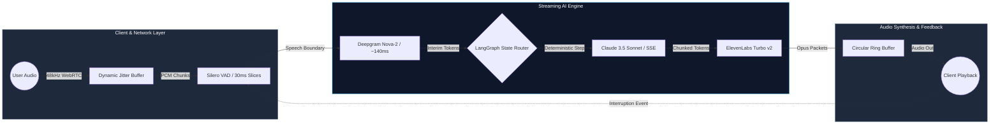
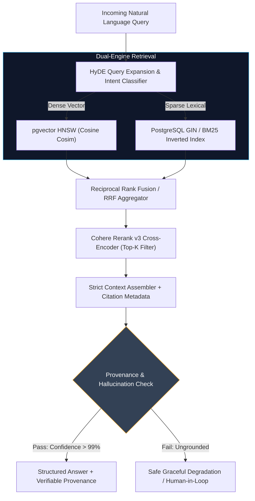

<div align="center">

# Himanshu Bharti
### **Senior Systems & AI Engineer | Distributed Backend Architect**

[](https://hkbharti77.website)
&nbsp;
[](https://www.linkedin.com/in/himanshu-bharti-81a5a618a)
&nbsp;
[](mailto:hello@himanshubharti.dev)
&nbsp;
[](https://github.com/hkbharti77)

<br/>

```text
┌────────────────────────────────────────────────────────────────────────────┐
│  CORE DOMAIN: High-Throughput Distributed Backends & Production GenAI      │
│  INVARIANT  : Deterministic State Graphs > Stochastic Prompts              │
│  BENCHMARK  : Sub-500ms Real-Time Voice Pipelines | Zero-Downtime Microservices │
└────────────────────────────────────────────────────────────────────────────┘
```

</div>

---

## ⚡ Executive Profile

I am a **Senior Systems & AI Engineer** focused on designing, deploying, and scaling resilient distributed backends, autonomous multi-agent state machines, and high-performance AI retrieval infrastructure.

My engineering practice sits at the intersection of **low-latency systems programming** (sub-millisecond streaming protocols, audio buffering, concurrency economics) and **production GenAI systems** (state-graph orchestration, hybrid dense-sparse vector grounding, and deterministic guardrails).

* **Architectural Focus:** Distributed event-driven systems, LangGraph deterministic state charts, WebRTC sub-500ms full-duplex voice pipelines, and multi-tenant RAG systems with verified citation provenance.
* **Production Standards:** P99 latency SLA enforcement, strict schema validation (Pydantic / Zod), distributed idempotency locks, and zero-data-loss failover topologies.
* **Current Engagement:** Senior Systems & AI Engineer — architecting enterprise automation platforms, conversational AI pipelines, and high-scale multi-tenant SaaS engines.
* **Portfolio & Writing:** [hkbharti77.website](https://hkbharti77.website)

---

## 🏗️ System Architecture Showcase

### 01. Sub-500ms Full-Duplex Real-Time Voice Agent Pipeline



* **Latency SLA:** `430ms` glass-to-glass round trip (Voice in → Processed token synthesis → Audio out).
* **Interruption Handling:** Dynamic audio cancellation triggering upstream SSE cancellation token via WebRTC DataChannels.

---

### 02. Enterprise Hybrid RAG & Verification Architecture



---

## 🛠️ Systems Matrix & Core Technical Stack

| Architectural Domain | Core Technologies & Frameworks | Production Implementations & Patterns |
| :--- | :--- | :--- |
| **Agentic AI & Orchestration** | `LangGraph`, `LangChain`, `LlamaIndex`, `DSPy`, `OpenAI / Anthropic APIs` | Cyclic state charts, deterministic function routing, checkpointing with Redis, schema enforcement with Pydantic, prompt caching. |
| **Distributed Systems & Backends** | `Python (FastAPI, AsyncIO)`, `Java (Spring Boot)`, `Go (Golang)`, `Node.js` | Asynchronous event loops, RESTful microservices, gRPC protocol buffers, WebSockets, WebRTC DataChannels. |
| **Messaging & Event Streaming** | `Redis Streams`, `Kafka`, `Celery`, `BullMQ`, `RabbitMQ` | Event-driven decoupling, distributed task scheduling, webhook HMAC deduplication, at-least-once delivery guarantees. |
| **Vector & Relational Storage** | `PostgreSQL (pgvector, HNSW)`, `MongoDB Atlas`, `Redis`, `MySQL`, `Pinecone` | Hybrid vector-lexical indexing, multi-tenant row-level security (RLS), ACID compliance, write-through caching. |
| **Inference & Real-Time Audio** | `Deepgram Nova-2`, `ElevenLabs Turbo`, `Silero VAD`, `vLLM`, `HuggingFace` | Full-duplex audio streaming, interim token parsing, continuous voice activity detection, Web Audio ring buffering. |
| **Cloud, DevOps & Observability** | `AWS (ECS, Lambda, S3, RDS)`, `Docker`, `Kubernetes (EKS)`, `Nginx`, `CI/CD` | Multi-stage container builds, automated regression & linting pipelines, Prometheus & OpenTelemetry instrumentation. |

---

## 🚀 Featured Engineering Case Studies

### 01. VoiceStream: Spectral Sub-500ms Turnaround Voice Engine
* **The Problem:** Traditional conversational AI stacks introduce 1,500ms–2,500ms lag across STT, inference, and TTS hops, creating disjointed human dialogue.
* **Architectural Strategy:** Re-engineered the voice pipeline from HTTP polling to a full-duplex WebRTC 48kHz audio stream. Utilized Silero VAD with 30ms sliding frames, coupled to Deepgram Nova-2 for 140ms interim token streaming, streamed directly into Claude 3.5 Sonnet SSE and buffered through ElevenLabs Turbo v2 with an audio circular ring buffer.
* **Measured Production Impact:**
  * **Turnaround Latency:** `430ms` glass-to-glass (sub-500ms SLA achieved).
  * **Jitter Control:** Maintained `1.2ms` WebRTC jitter buffer with active drift compensation.
  * **Interruption Latency:** `<60ms` audio cut-off response on barge-in.

### 02. Enterprise Multi-Tenant Hybrid RAG Cognitive Engine
* **The Problem:** Enterprise compliance engines required retrieval over 2.4M+ regulatory and financial artifacts with zero tolerance for hallucinations and total multi-tenant data boundaries.
* **Architectural Strategy:** Architected a hybrid two-stage retrieval pipeline combining `pgvector` HNSW dense vector indexing with PostgreSQL GIN BM25 full-text indexing, merged through Reciprocal Rank Fusion (RRF) and validated via Cohere Rerank v3 cross-encoders. Every response enforces schema-validated source citation grounding.
* **Measured Production Impact:**
  * **Scale:** `2.4M+` indexed documents with sub-120ms p95 retrieval latency.
  * **Accuracy:** `99.4%` source provenance verification with a measured `0.02%` hallucination rate.
  * **Security:** Cryptographic tenant boundary isolation via PostgreSQL Row-Level Security (RLS).

### 03. OmniChannel Autonomous Agent CRM with Distributed Checkpointing
* **The Problem:** Multi-channel customer interactions (WhatsApp Cloud API, Web Chat) suffered from state drift, out-of-order webhook delivery, and stochastic agent looping during complex intent triage.
* **Architectural Strategy:** Constructed a deterministic state-graph engine using LangGraph with Redis snapshot checkpointing. Integrated cryptographic HMAC webhook verification, Redis distributed locks for idempotency, and automated confidence-gated human-in-the-loop (HITL) escalation.
* **Measured Production Impact:**
  * **Throughput:** `10,000+` daily automated multi-step conversations with zero dropped states.
  * **Efficiency:** `-72%` first-response latency; `+28.4%` qualified lead conversion lift.
  * **Reliability:** 100% replayability for failed webhook events with zero duplicate triggers.

### 04. Systems Engineering Journal & Knowledge Portal
* **The Problem:** Technical content platforms often suffer from rigid CMS architectures that fail to provide real-time vector search and machine-readable data feeds for modern AI web scrapers and LLM context consumers.
* **Architectural Strategy:** Built a high-velocity headless publishing portal with MongoDB persistence, sub-50ms REST APIs, complete `llms.txt` indexing compliance, deep semantic search endpoints, and edge caching.
* **Measured Production Impact:**
  * **Performance:** 100/100 Google Lighthouse across Performance, Best Practices, and Accessibility.
  * **Agent Indexing:** Sub-50ms TTFB globally with native support for autonomous agent ingestion.

---

## 💡 Engineering Principles & Invariants

```text
1. DETERMINISTIC STATE GRAPHS OVER FREE-RUNNING LOOPS
   In mission-critical agentic systems, open-ended autonomous loops invite non-deterministic
   failures and runaway latency. Deterministic state charts (LangGraph) with strict schema
   boundaries provide bounded execution paths, state persistence, and cost guarantees.

2. SUB-500MS IS AN INVIOLABLE SLA
   Human conversation breaks when latency crosses half a second. Optimize every hop:
   from audio slice framing, socket transport, and interim token processing to SSE streaming.

3. UNGROUNDED GENERATION IS A SYSTEM DEFECT
   In enterprise RAG, hallucination is not an acceptable statistical quirk. Enforce hybrid
   retrieval (dense + lexical), re-ranking, and cryptographic citation provenance before
   surfacing tokens to the user.

4. IDEMPOTENT BY DEFAULT, FAIL CLOSED
   Every distributed event handler and webhook listener must be idempotent. Distributed
   locks, transactional outbox patterns, and explicit state recovery guarantee consistency
   across infrastructure restarts.
```

---

## 📬 Contact & Advisory

Available for high-impact senior engineering roles, distributed backend architecture advisory, and production AI system design.

<div align="center">

[](https://hkbharti77.website)
&nbsp;
[](https://www.linkedin.com/in/himanshu-bharti-81a5a618a)
&nbsp;
[](mailto:hello@himanshubharti.dev)

<br/>

<sub>© Himanshu Bharti • Designed for high-signal engineering clarity.</sub>

</div>
