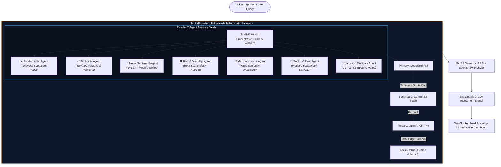
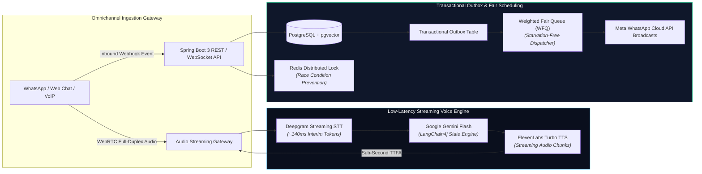

<div align="center">

<!-- Modern Broadsheet Hero Header -->
<a href="https://hkbharti77.website">
  
</a>

<p align="center">
  <b>🔬 Junior Research Fellow @ National Quantum Mission (DST, Govt. of India)</b> • <i>Dept. of ECE, IIIT Bhagalpur</i><br/>
  <b>💻 Ex-Software Development Engineer @ Mobiloitte</b> • <i>Full Stack, Distributed Backend & AI Systems</i>
</p>

<p align="center">
  <a href="https://hkbharti77.website">
    
  </a>
  &nbsp;
  <a href="https://www.linkedin.com/in/himanshu-bharti-81a5a618a">
    
  </a>
  &nbsp;
  <a href="mailto:hkbharti77@gmail.com">
    
  </a>
  &nbsp;
  <a href="https://wa.me/917050047159">
    
  </a>
  &nbsp;
  <a href="https://github.com/hkbharti77">
    
  </a>
</p>

</div>

---

<!-- 2026 Bento Grid KPI Telemetry -->
## 📊 Production Telemetry & Verified Impact

<div align="center">

<table>
  <tr>
    <td width="33%" align="center" bgcolor="#0f172a">
      <h3 style="margin: 0; color: #38bdf8;">⚡ -30%</h3>
      <b>Query Latency</b><br/>
      <sub>Hybrid RAG (dense + BM25) with Redis semantic caching</sub>
    </td>
    <td width="33%" align="center" bgcolor="#0f172a">
      <h3 style="margin: 0; color: #38bdf8;">🚀 -45%</h3>
      <b>Inference Latency</b><br/>
      <sub>Spring AI + Gemini prompt routing & response caching</sub>
    </td>
    <td width="33%" align="center" bgcolor="#0f172a">
      <h3 style="margin: 0; color: #38bdf8;">🎙️ &lt; 1.0s</h3>
      <b>Time-to-First-Audio</b><br/>
      <sub>Deepgram + ElevenLabs bidirectional streaming Voice AI</sub>
    </td>
  </tr>
  <tr>
    <td width="33%" align="center" bgcolor="#0f172a">
      <h3 style="margin: 0; color: #10b981;">📡 10,000+</h3>
      <b>Campaign Scale</b><br/>
      <sub>Automated outbound calls & broadcasts with async queues</sub>
    </td>
    <td width="33%" align="center" bgcolor="#0f172a">
      <h3 style="margin: 0; color: #10b981;">📈 +35%</h3>
      <b>Lead Response Rate</b><br/>
      <sub>Event-driven Slack Bot lead routing via async webhooks</sub>
    </td>
    <td width="33%" align="center" bgcolor="#0f172a">
      <h3 style="margin: 0; color: #10b981;">⏱️ -25%</h3>
      <b>Resolution Time</b><br/>
      <sub>Enterprise omnichannel live agent handoff across 4 platforms</sub>
    </td>
  </tr>
</table>

</div>

---

<!-- Executive Bento Dossier -->
## 🧭 Architectural Bento Dossier

<table>
  <tr>
    <td width="50%" valign="top">
      <h3>🔬 Quantum Lab Control & Scientific DAQ</h3>
      <p><b>National Quantum Mission (DST, Govt. of India) @ IIIT Bhagalpur</b></p>
      <ul>
        <li>Developing software control modules and automated data acquisition (DAQ) workflows in <b>Python</b> and <b>C/C++</b>.</li>
        <li>Engineering low-level hardware-interfacing logic to stream live instrumentation telemetry from experimental quantum test benches.</li>
        <li>Conducting numerical modeling, algorithm verification, and precision data analysis.</li>
      </ul>
      <p><b>Core Stack:</b> <code>Python</code> <code>C/C++</code> <code>MATLAB</code> <code>Hardware DAQ</code> <code>Linux</code></p>
    </td>
    <td width="50%" valign="top">
      <h3>⚡ High-Performance Distributed Backends</h3>
      <p><b>Microservices Architecture & Multi-Tenant SaaS Engines</b></p>
      <ul>
        <li>Building high-throughput asynchronous RESTful APIs with <b>FastAPI</b> and enterprise microservices with <b>Spring Boot 3</b>.</li>
        <li>Designing multi-tenant isolation layers across <b>PostgreSQL</b> (RLS), <b>MongoDB</b>, and <b>MySQL</b>.</li>
        <li>Preventing race conditions via <b>Redis Distributed Locks</b> and guaranteed delivery via the <b>Transactional Outbox Pattern</b>.</li>
      </ul>
      <p><b>Core Stack:</b> <code>Python</code> <code>FastAPI</code> <code>Java 17/21</code> <code>Spring Boot 3</code> <code>Docker</code></p>
    </td>
  </tr>
  <tr>
    <td width="50%" valign="top">
      <h3>🎙️ Full-Duplex Real-Time Voice AI</h3>
      <p><b>Sub-Second Voice Turnaround & Conversational IVR</b></p>
      <ul>
        <li>Architecting real-time streaming pipelines over <b>WebSockets</b> and <b>WebRTC</b> with SIP/TLS signaling.</li>
        <li>Streaming interim transcripts via <b>Deepgram Nova-2</b> into LLMs with early sentence token forwarding to <b>ElevenLabs TTS</b>.</li>
        <li>Implementing 20–30ms PCM frame buffering with Silero VAD and dynamic barge-in interruption cancellation.</li>
      </ul>
      <p><b>Core Stack:</b> <code>WebRTC</code> <code>WebSockets</code> <code>Deepgram</code> <code>ElevenLabs</code> <code>VAD</code></p>
    </td>
    <td width="50%" valign="top">
      <h3>🧠 Autonomous Agent Graphs & Hybrid RAG</h3>
      <p><b>Deterministic Multi-Agent Coordination & Semantic Retrieval</b></p>
      <ul>
        <li>Engineering parallel multi-agent workflows with <b>LangGraph</b> and <b>LangChain4j</b> using strict Pydantic/Java schemas.</li>
        <li>Implementing hybrid retrieval pipelines merging <b>pgvector HNSW</b> dense vectors and full-text lexical search via <b>RRF</b>.</li>
        <li>Resilient multi-provider failover waterfalls: <code>DeepSeek</code> &rarr; <code>Gemini</code> &rarr; <code>GPT-4o</code> &rarr; <code>Ollama</code>.</li>
      </ul>
      <p><b>Core Stack:</b> <code>LangGraph</code> <code>LangChain4j</code> <code>pgvector</code> <code>FAISS</code> <code>Gemini API</code></p>
    </td>
  </tr>
</table>

---

## 🏗️ Interactive System Blueprints

### 📈 01. AI Stock Kundli: 7-Agent Parallel Analysis & Multi-LLM Waterfall



<details>
<summary><b>🔍 View AI Stock Kundli Technical Deep-Dive & Architecture Invariants</b></summary>
<br/>

* **Asynchronous Concurrency:** Utilizes FastAPI with SQLAlchemy 2.0 async sessions and Redis quotas to evaluate 7 specialized agents concurrently without blocking the main event loop.
* **LLM Waterfall Resilience:** Shields the platform against API rate limits and vendor outages via cascading fallback logic: `DeepSeek V3` (primary analytical reasoning) &rarr; `Gemini 2.5 Flash` (high-throughput fallback) &rarr; `GPT-4o` &rarr; local self-hosted `Ollama`.
* **Domain Financial NLP:** Custom **FinBERT** sentiment analysis scores market news sentiment alongside **FAISS** vector similarity indexing on company filings.
* **Secure Client Delivery:** Next.js 14 frontend renders real-time WebSocket feeds with bilingual localization (English/Hindi) and secure Razorpay webhook signature verification (HMAC SHA-256).

</details>

---

### 🏢 02. GyanVaniAI Connect: Voice AI & Transactional Outbox CRM



<details>
<summary><b>🔍 View GyanVaniAI Connect Technical Deep-Dive & Reliability Invariants</b></summary>
<br/>

* **Full-Duplex Voice Turnaround:** WebRTC audio streaming coupled with interim STT tokens allows sentence-boundary token streaming directly into ElevenLabs, delivering conversational interactions with sub-second Time-to-First-Audio.
* **Transactional Outbox Pattern:** Inbound webhooks write atomic events into PostgreSQL before dispatching, guaranteeing at-least-once broadcast delivery without distributed transaction failures.
* **Fair Scheduling (WFQ):** Weighted Fair Queueing dispatches high-priority real-time client messages while preventing bulk broadcast campaigns from starving active conversations.
* **Concurrency Protection:** PostgreSQL pessimistic row-locking (`SELECT FOR UPDATE`) combined with Redis distributed locks prevents double-allocation of leads during peak chatbot traffic.

</details>

---

## 💼 Professional Experience Timeline

```text
2026 ────────────────────────────────────────────────────────────────────────► Present
│
├── 🔬 IIIT Bhagalpur (Oct 2026 – Present)
│   Junior Research Fellow (JRF) – National Quantum Mission (DST, Govt. of India)
│   • Python & C/C++ automated data acquisition (DAQ) and quantum experimental test benches.
│   • Hardware interfacing routines for laboratory instrumentation and telemetry streams.
│   • Numerical modeling, algorithm verification, and experimental physical data analysis.
│
├── 💻 Mobiloitte Technologies (May 2025 – Oct 2026)
│   Software Development Engineer (Full Stack & AI)
│   • 5-Channel conversational AI bots (WhatsApp, Telegram, Instagram, Slack, Web Chat).
│   • Cut query latency by 30% via Hybrid RAG (dense + BM25) and Redis semantic caching.
│   • Sub-second Voice AI IVR with Deepgram STT, ElevenLabs TTS, and bidirectional WebSockets.
│   • Meta WhatsApp Cloud API automated onboarding for 10+ enterprise WABA client accounts.
│   • Scaled outbound campaign broadcast engine handling 10,000+ interactions.
│
└── 🛠️ QSpiders (Aug 2024 – Apr 2025)
    Full Stack Developer Intern
    • Layered Spring Boot microservices with JSR-380 validation, reducing response times by 20%.
    • MySQL relational schema optimization, cutting join query execution times by 25%.
    • Modular React UI dashboards with JUnit/Mockito test suites achieving 80%+ coverage.
```

---

## 🛠️ Complete Technical Ecosystem

<table>
  <tr>
    <td width="25%"><b>Languages & Core</b></td>
    <td><code>Python</code> <code>Java (17/21)</code> <code>C/C++</code> <code>TypeScript</code> <code>JavaScript</code> <code>SQL</code></td>
  </tr>
  <tr>
    <td width="25%"><b>Backend Frameworks</b></td>
    <td><code>FastAPI</code> <code>Spring Boot 3</code> <code>AsyncIO</code> <code>RESTful APIs</code> <code>WebSockets</code> <code>Microservices</code></td>
  </tr>
  <tr>
    <td width="25%"><b>AI, RAG & LLMs</b></td>
    <td><code>LangChain</code> <code>LangGraph</code> <code>LangChain4j</code> <code>Spring AI</code> <code>LlamaIndex</code> <code>FAISS</code> <code>pgvector</code> <code>FinBERT</code></td>
  </tr>
  <tr>
    <td width="25%"><b>Voice & Streaming</b></td>
    <td><code>WebRTC</code> <code>Deepgram Streaming STT</code> <code>ElevenLabs TTS</code> <code>Silero VAD</code> <code>Audio Ring Buffers</code></td>
  </tr>
  <tr>
    <td width="25%"><b>Databases & Caching</b></td>
    <td><code>PostgreSQL (RLS, HNSW)</code> <code>MongoDB</code> <code>MySQL</code> <code>Redis (Locking & Caching)</code> <code>SQLAlchemy</code></td>
  </tr>
  <tr>
    <td width="25%"><b>Cloud, DevOps & Tools</b></td>
    <td><code>Docker</code> <code>AWS (EC2, S3)</code> <code>Git</code> <code>GitHub Actions</code> <code>Nginx</code> <code>Linux</code> <code>MATLAB</code> <code>Postman</code></td>
  </tr>
  <tr>
    <td width="25%"><b>Integrations & Frontend</b></td>
    <td><code>Meta WhatsApp Cloud API</code> <code>Slack API</code> <code>Next.js 14</code> <code>React 19</code> <code>Tailwind CSS</code> <code>Razorpay API</code></td>
  </tr>
</table>

---

## 📜 Certifications & Academic Credentials

<div align="center">

| **Certifications & Specializations** | **Academic Background** |
| :--- | :--- |
| 🏅 **Salesforce Trailhead Superbadges:** Apex Specialist & Process Automation Specialist *(2024)* | 🎓 **B.Tech in Electronics & Communication Engineering**<br/><i>Bihar Engineering University</i> • **CGPA: 7.8 / 10** *(2020 – 2024)* |
| 🛡️ **Cisco CyberOps Associate:** Cisco Networking Academy *(2024)* | 🏫 **Class XII (Senior Secondary) – Science (PCM)**<br/><i>R.M. College (BSEB)</i> • **68%** *(2018 – 2020)* |
| 🌐 **Cisco CCNA: Introduction to Networks (CCNAv7):** Cisco Academy *(2023)* | 🏫 **Class X (Secondary School Certificate)**<br/><i>St. Xavier’s School</i> • **CGPA: 9.4 / 10** |

</div>

---

## 💡 Systems Invariants & Design Principles

```text
1. BOUNDED STATE MACHINES OVER UNCHECKED LOOPS
   In autonomous and conversational agents, unconstrained loops invite non-deterministic
   failures and runaway latency. Deterministic state charts with strict Pydantic/Java
   schema validation guarantee bounded execution paths and predictable operating costs.

2. MULTI-PROVIDER WATERFALL FOR MISSION-CRITICAL AI
   Single-provider LLM architectures represent a severe single point of failure.
   Cascading waterfalls (DeepSeek -> Gemini -> GPT-4o -> Local Ollama) guarantee high
   availability, graceful degradation, and business continuity.

3. IDEMPOTENT BY DEFAULT & THE TRANSACTIONAL OUTBOX
   In multi-channel webhook architectures (WhatsApp, Slack, Razorpay), network retries and
   duplicates are inevitable. Redis distributed locks and the Transactional Outbox Pattern
   guarantee that side-effects execute exactly once without race conditions.

4. LATENCY DECOMPOSITION IS A SYSTEM-LEVEL METRIC
   Sub-second Voice AI is not achieved by choosing WebRTC alone. It requires holistic
   pipeline optimization: 20–30ms PCM audio slicing, interim token streaming, early
   sentence synthesis, and dynamic barge-in buffer cancellation.
```

---

## 📬 Connect & Direct Contact

<div align="center">

[](https://hkbharti77.website)
&nbsp;
[](https://www.linkedin.com/in/himanshu-bharti-81a5a618a)
&nbsp;
[](mailto:hkbharti77@gmail.com)
&nbsp;
[](https://wa.me/917050047159)

<br/>

<sub>© 2026 Himanshu Bharti • SDE & Junior Research Fellow (National Quantum Mission, DST) • Engineered for high-signal technical clarity.</sub>

</div>
