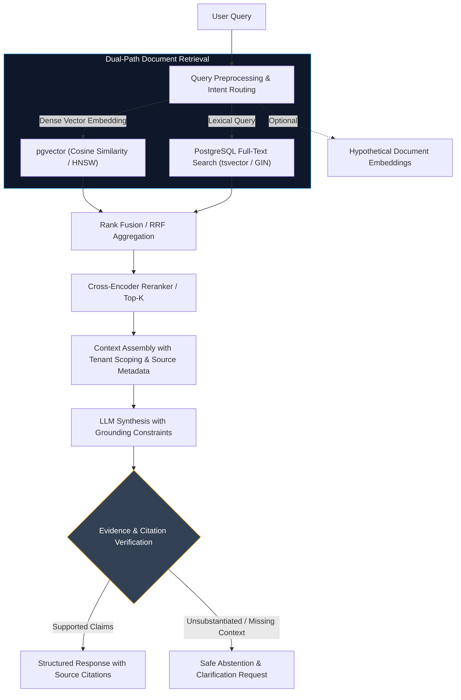

<div align="center">

# Himanshu Bharti
### **Systems & AI Engineer | Backend & Distributed Systems**

[](https://hkbharti77.website)
&nbsp;
[](https://www.linkedin.com/in/himanshu-bharti-81a5a618a)
&nbsp;
[](mailto:hkbharti77@gmail.com)
&nbsp;
[](https://github.com/hkbharti77)

<br/>

```text
┌────────────────────────────────────────────────────────────────────────────┐
│  CORE DOMAIN : High-Performance Backends, Conversational AI & Hybrid RAG   │
│  INVARIANT   : Bounded State Machines > Uncontrolled Stochastic Loops      │
│  OBJECTIVE   : Low-Latency Streaming, Idempotent APIs & Reliable Services  │
└────────────────────────────────────────────────────────────────────────────┘
```

</div>

---

## ⚡ Executive Profile

I am a **Systems & AI Engineer** specializing in backend development, distributed service integration, and production-grade conversational AI workflows.

My work centers on building scalable REST and streaming services, structured multi-agent state machines, and evidence-grounded Retrieval-Augmented Generation (RAG) systems. I focus on end-to-end reliability: designing resilient relational models, implementing idempotent event handlers, enforcing strict schema validation, and optimizing data retrieval pipelines.

* **Primary Stack:** Python (FastAPI, AsyncIO), Java (Spring Boot), PostgreSQL, Redis, Docker.
* **AI & Retrieval Focus:** Agentic state machines (LangGraph), hybrid dense-sparse retrieval (pgvector + full-text search), streaming STT/TTS integration, and citation validation.
* **Systems Discipline:** API contract enforcement (Pydantic / Zod), distributed locking, tenant isolation, and measurement-driven latency reduction.
* **Portfolio & Dispatches:** [hkbharti77.website](https://hkbharti77.website)

---

## 🏗️ System Architecture Showcase

### 01. Real-Time Streaming Voice AI Pipeline

```mermaid
flowchart LR
    subgraph Ingestion ["1. Audio Capture & Transport"]
        A[Client Microphone] -->|WebRTC / Opus| B[Dynamic Jitter Buffer]
        B -->|Decoded PCM| C[Voice Activity Detection / VAD]
    end

    subgraph StreamingCore ["2. Streaming Inference Pipeline"]
        C -->|Audio Chunks / 20-30ms| D[Streaming STT Engine]
        D -->|Interim Transcripts| E[Session & Agent Orchestrator]
        E -->|Context & Structured Prompt| F[Streaming LLM Generation]
        F -->|Token Stream / SSE| G[Streaming TTS Engine]
    end

    subgraph Playback ["3. Audio Delivery"]
        G -->|Audio Chunks| H[Audio Buffer / Queue]
        H -->|WebRTC / WebSocket Stream| I[Client Speaker Playback]
        I -.->|Barge-in / Interruption Event| C
    end

    style Ingestion fill:#1e293b,stroke:#64748b,stroke-width:1px,color:#fff
    style StreamingCore fill:#0f172a,stroke:#38bdf8,stroke-width:1px,color:#fff
    style Playback fill:#1e293b,stroke:#64748b,stroke-width:1px,color:#fff
```



#### Latency Decomposition & Protocol Invariants
* **Transport Optimization:** Uses WebRTC data and media channels to eliminate TCP connection setup and head-of-line blocking on audio packets. Note that while WebRTC minimizes transport overhead, total end-of-turn latency remains dominated by model compute (STT processing + LLM time-to-first-token + TTS chunk synthesis).
* **Chunked Streaming:** Pipelining interim STT transcripts into the LLM and forwarding early token chunks to TTS overlap inference phases, reducing perceived turn turnaround time compared to sequential batch execution.
* **Interruption Handling (Barge-In):** When client-side VAD detects user speech during playback, an explicit cancellation event aborts upstream LLM token generation and flushes downstream audio buffers.

---

### 02. Multi-Tenant Hybrid RAG & Verification Architecture



#### Retrieval Mechanics & Quality Controls
* **Dense & Lexical Complementarity:** Dense vectors capture semantic intent, while PostgreSQL full-text search (`tsvector` + GIN inverted indexes) guarantees exact matches for product SKUs, legal references, and specific entity names.
* **Rank Fusion & Re-Scoring:** Reciprocal Rank Fusion (RRF) standardizes scores across dense and lexical result sets before a cross-encoder model evaluates query-document relevance.
* **Safe Abstention Over Hallucination:** The system validates that claims generated by the LLM map directly to retrieved chunk metadata; if evidence is insufficient, the system abstains rather than producing unsupported outputs.

---

## 🛠️ Technical Stack & Competency Matrix

| Category | Primary Technologies | Application in Projects |
| :--- | :--- | :--- |
| **Core & Demonstrable**<br/>*(Production & Daily Stack)* | `Python`, `FastAPI`, `AsyncIO`, `Java`, `Spring Boot`, `PostgreSQL`, `pgvector`, `Redis`, `REST APIs`, `WebSockets`, `Docker`, `Git` | Designing asynchronous microservices, building relational and vector schemas, implementing Redis caching and session locking, containerizing services. |
| **Applied & Experimental**<br/>*(Active Projects & Pipelines)* | `LangGraph`, `LangChain`, `WebRTC`, `Deepgram STT`, `ElevenLabs TTS`, `OpenAI / Anthropic APIs`, `MongoDB`, `Nginx`, `Pydantic` | Constructing cyclic agent state graphs, integrating real-time audio and STT/TTS streams, configuring reverse proxy routing, validating structured schemas. |
| **Familiarity & Continuous Learning**<br/>*(Architectural Study)* | `Go (Golang)`, `Kafka`, `Kubernetes (EKS)`, `Cross-Encoder Rerankers`, `Distributed Consensus Patterns` | Exploring high-throughput message brokers, orchestrating containerized microservices, studying advanced ranking functions and consensus mechanics. |

---

## 🚀 Featured Engineering Case Studies

### 01. Real-Time Voice AI Pipeline with Streaming STT and TTS
* **Problem:** Conversational voice interfaces fail when conversational lag exceeds human conversational tolerance (typically >700–1000ms), or when users cannot interrupt the agent mid-sentence.
* **Architecture & Design Decisions:**
  * Replaced sequential request-response cycles with an asynchronous streaming pipeline over WebRTC.
  * Audio is sliced into 20–30ms PCM frames, processed by Voice Activity Detection (Silero VAD), and streamed into Deepgram for low-latency interim speech recognition.
  * Interim tokens stream into Claude / GPT models via Server-Sent Events (SSE); the first sentence boundaries trigger streaming text-to-speech (TTS) synthesis immediately.
* **Personal Contribution:** Architected the Python backend orchestrator, configured WebRTC media handlers, implemented sliding-window audio buffering, and built the cancellation event loop for instant barge-in support.
* **Tech Stack:** `Python`, `FastAPI`, `WebRTC`, `Deepgram API`, `Anthropic / OpenAI API`, `ElevenLabs API`, `Docker`.
* **Testing & Limitations:** Benchmarked locally and in staging environments for streaming stability. *Known Limitation:* Total latency fluctuates based on network jitter and third-party inference turnaround; fallback mechanisms handle connection degradation gracefully.

---

### 02. Multi-Tenant Hybrid RAG with Retrieval and Citation Validation
* **Problem:** Enterprise knowledge systems require strict tenant isolation and reliable document grounding; standard vector search alone frequently misses exact code identifiers or returns irrelevant chunks for complex queries.
* **Architecture & Design Decisions:**
  * Implemented a hybrid retrieval architecture combining `pgvector` (HNSW indexing) for semantic search with PostgreSQL native full-text search (`tsvector` + GIN indexing) for exact lexical matches.
  * Combined candidate documents using Reciprocal Rank Fusion (RRF) and applied a cross-encoder model to re-score top results before context injection.
  * Enforced multi-tenant isolation at the database layer using PostgreSQL Row-Level Security (RLS) linked to authenticated tenant contexts.
* **Personal Contribution:** Designed the PostgreSQL schema, tuned vector index parameters (HNSW `m` and `ef_construction`), developed chunking and embedding pipelines, and implemented strict source-citation prompt templates with validation checks.
* **Tech Stack:** `Python`, `FastAPI`, `PostgreSQL`, `pgvector`, `Cohere Rerank / Cross-Encoder`, `LangChain`, `Pydantic`.
* **Testing & Limitations:** Tested across diverse technical document corpora. *Known Limitation:* While citation checks confirm that retrieved passages match generated text, human validation remains necessary for high-stakes regulatory decisions.

---

### 03. Omnichannel CRM Automation with Idempotent Webhooks
* **Problem:** High-volume multi-channel communication (e.g., WhatsApp Cloud API, Web Chat) frequently encounters out-of-order deliveries, network retries, duplicate webhook notifications, and unexpected conversational branch failures.
* **Architecture & Design Decisions:**
  * Implemented cryptographic HMAC signature verification on all inbound webhooks to prevent spoofing.
  * Built an idempotency layer using Redis distributed locks and unique message ID tracking with time-to-live (TTL) expiration to reject duplicate event deliveries safely.
  * Structured conversation flows as deterministic directed state graphs (LangGraph) with Redis checkpointing, ensuring session state persists across server restarts.
  * Added automated human-in-the-loop (HITL) routing when intent confidence falls below configured thresholds.
* **Personal Contribution:** Engineered the webhook ingestion pipeline, implemented Redis idempotency guards, designed the conversational state graph, and integrated third-party messaging APIs.
* **Tech Stack:** `Python`, `FastAPI`, `LangGraph`, `Redis`, `PostgreSQL`, `WhatsApp Cloud API`, `Docker`.
* **Testing & Limitations:** Evaluated under burst webhook load scenarios. *Known Limitation:* Redis state caching requires regular persistence snapshots to PostgreSQL to prevent state loss during cache eviction.

---

### 04. Engineering Knowledge Portal with Search and Structured Content
* **Problem:** Technical engineering articles and systems documentation require fast rendering, clean categorization, and machine-readable indexing for automated AI discovery.
* **Architecture & Design Decisions:**
  * Developed a decoupled architecture featuring an Express/Node.js API and dynamic document store paired with an optimized client interface.
  * Structured data persistence in MongoDB with indexed queries and caching layers to minimize database round-trips.
  * Integrated an `llms.txt` endpoint adhering to current standards for LLM search agents and automated context ingestion.
  * Implemented structured metadata, OpenGraph cards, and accessible semantic HTML.
* **Personal Contribution:** Built backend API endpoints, configured MongoDB database indexes, implemented telemetry and cookie consent controls, and designed machine-readable export formats.
* **Tech Stack:** `Node.js`, `Express`, `MongoDB`, `React`, `TypeScript`, `Tailwind CSS`.
* **Testing & Limitations:** Tested via automated unit test suites for consent lifecycle tracking and API response consistency. *Known Limitation:* Dynamic client rendering requires edge caching strategies to ensure optimal response times across global regions.

---

## 💡 Engineering Principles

```text
1. EXPLICIT STATE BOUNDS OVER UNCHECKED LOOPS
   In conversational and autonomous systems, free-running loops lead to non-deterministic
   failures and unpredictable token usage. Deterministic state machines with explicit
   branching and schema validation enforce bounded execution and reliable recovery.

2. MEASUREMENT-DRIVEN LATENCY OPTIMIZATION
   Streaming responsiveness requires auditing each pipeline stage: audio framing, socket
   transport, serialization, model time-to-first-token, and synthesis buffering.
   Avoid optimizing one component while ignoring bottlenecks in another.

3. EVIDENCE-BASED RAG GROUNDING & SAFE ABSTENTION
   Reduce unsupported generation through hybrid retrieval, citation verification, and explicit
   abstention policies. A system that acknowledges missing information is fundamentally
   more valuable than one that invents plausible details.

4. IDEMPOTENT PROCESSING & RELIABLE STATE RECOVERY
   Treat every inbound network event as potentially duplicated or delayed. Enforce
   distributed deduplication keys, atomic state updates, and graceful fallback paths
   across all asynchronous interfaces.
```

---

## 📬 Contact & Collaboration

Open to technical discussions, backend engineering challenges, and systems architecture collaboration.

<div align="center">

[](https://hkbharti77.website)
&nbsp;
[](https://www.linkedin.com/in/himanshu-bharti-81a5a618a)
&nbsp;
[](mailto:hkbharti77@gmail.com)

<br/>

<sub>© Himanshu Bharti • Designed for high-signal engineering clarity.</sub>

</div>
